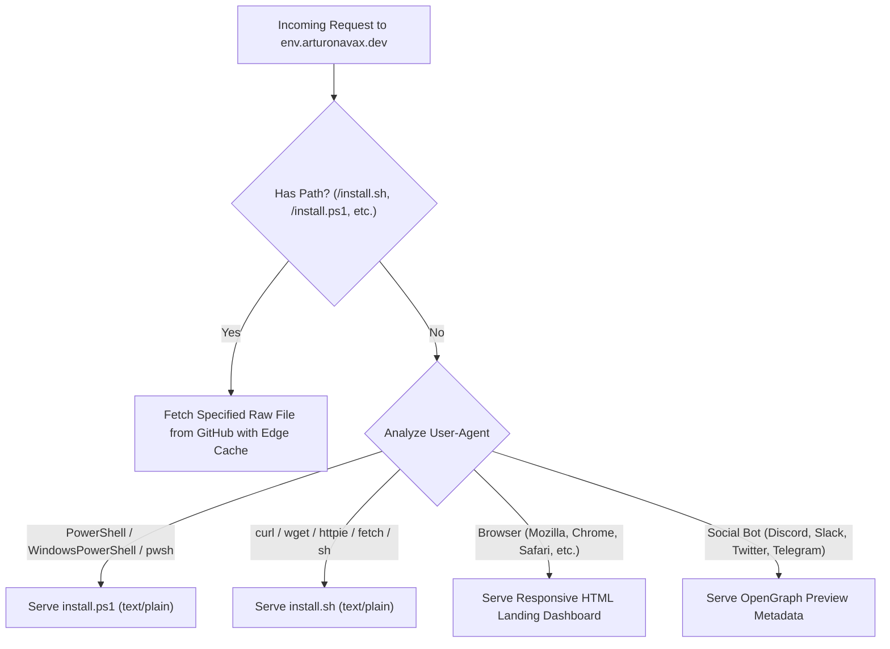

# Production Edge Router: Cloudflare Worker Guide

Comprehensive architecture and deployment guide for serving `env.arturonavax.dev` as an intelligent, zero-latency edge distribution router using Cloudflare Workers.

---

## 1. Architectural Philosophy

Modern CLI tools like Docker (`get.docker.com`), Rustup (`sh.rustup.rs`), Bun (`bun.sh`), and UV (`astral.sh/uv`) distribute their setup scripts through edge routers rather than static file links.

By placing a Cloudflare Worker on `env.arturonavax.dev/*`:

1. **Intelligent User-Agent Detection**:
   - `curl` or `wget` without path -> automatically delivers `install.sh` (`text/plain; charset=utf-8`).
   - PowerShell (`irm`) without path -> automatically delivers `install.ps1`.
   - Web Browsers -> serves a responsive, dark-mode terminal dashboard with single-click command copy buttons.
   - Discord / Slack / Telegram crawlers -> serves rich OpenGraph metadata preview cards.
2. **Edge Caching & Resiliency**:
   - Eliminates GitHub raw rate limits by caching upstream script responses in Cloudflare's global edge network for 1 hour with `stale-while-revalidate`.
3. **Strict Content-Type Negotiation**:
   - Explicitly sets `Content-Type: text/plain; charset=utf-8` and `X-Content-Type-Options: nosniff` to guarantee clean piped execution in POSIX shells (`sh`, `dash`, `ash`, `bash`, `zsh`) and Windows PowerShell.

---

## 2. Universal Edge Routing Logic



---

## 3. Production Worker Implementation (`worker.ts`)

Create this file in your Cloudflare Worker project:

```typescript
/**
 * Cloudflare Worker: Intelligent Edge Router for arturonavax/env
 * Subdomain: env.arturonavax.dev
 */

interface Env {
  GITHUB_USER?: string;
  GITHUB_REPO?: string;
  DEFAULT_BRANCH?: string;
}

const GITHUB_USER = "arturonavax";
const GITHUB_REPO = "env";
const DEFAULT_BRANCH = "main";
const UPSTREAM_RAW_BASE = `https://raw.githubusercontent.com/${GITHUB_USER}/${GITHUB_REPO}/${DEFAULT_BRANCH}`;

// Cache TTL: 5 minutes edge cache, 1 hour s-maxage, stale-while-revalidate for 24h
const CACHE_CONTROL_HEADER = "public, max-age=300, s-maxage=3600, stale-while-revalidate=86400";

export default {
  async fetch(request: Request, env: Env, ctx: ExecutionContext): Promise<Response> {
    const url = new URL(request.url);
    const userAgent = request.headers.get("user-agent") || "";
    const lowerUA = userAgent.toLowerCase();

    // 1. Direct explicit file requests (e.g. /install.sh, /install.ps1, /install.bat)
    if (url.pathname !== "/" && url.pathname !== "") {
      return fetchUpstreamRaw(request, ctx, `${UPSTREAM_RAW_BASE}${url.pathname}`);
    }

    // 2. PowerShell / Windows Terminal detection
    if (
      lowerUA.includes("powershell") ||
      lowerUA.includes("pwsh") ||
      lowerUA.includes("windowspowershell")
    ) {
      return fetchUpstreamRaw(request, ctx, `${UPSTREAM_RAW_BASE}/install.ps1`);
    }

    // 3. Command-line downloaders (curl, wget, httpie, fetch, etc.)
    if (
      lowerUA.includes("curl") ||
      lowerUA.includes("wget") ||
      lowerUA.includes("httpie") ||
      lowerUA.includes("fetch") ||
      lowerUA.includes("aria2")
    ) {
      return fetchUpstreamRaw(request, ctx, `${UPSTREAM_RAW_BASE}/install.sh`);
    }

    // 4. Social crawlers (OpenGraph cards)
    if (
      lowerUA.includes("discordbot") ||
      lowerUA.includes("slackbot") ||
      lowerUA.includes("twitterbot") ||
      lowerUA.includes("telegrambot")
    ) {
      return serveSocialMetadata();
    }

    // 5. Interactive Desktop / Mobile Web Browsers -> HTML Dashboard
    return serveHTMLDashboard();
  },
};

/**
 * Fetches script from GitHub Raw with Cloudflare Edge Caching and strict security headers
 */
async function fetchUpstreamRaw(
  request: Request,
  ctx: ExecutionContext,
  targetUrl: string
): Promise<Response> {
  const cache = caches.default;
  const cacheKey = new Request(targetUrl, { method: "GET" });

  let response = await cache.match(cacheKey);
  if (!response) {
    const upstreamRes = await fetch(targetUrl, {
      headers: {
        "User-Agent": "Cloudflare-Worker-ANX-Installer-Router",
      },
    });

    if (!upstreamRes.ok) {
      return new Response(`[Router Error]: Failed to fetch installer script from upstream (${upstreamRes.status})`, {
        status: 502,
        headers: { "Content-Type": "text/plain; charset=utf-8" },
      });
    }

    const body = await upstreamRes.text();
    response = new Response(body, {
      status: 200,
      headers: {
        "Content-Type": "text/plain; charset=utf-8",
        "Cache-Control": CACHE_CONTROL_HEADER,
        "X-Content-Type-Options": "nosniff",
        "Access-Control-Allow-Origin": "*",
      },
    });

    // Store in Cloudflare global edge cache
    ctx.waitUntil(cache.put(cacheKey, response.clone()));
  }

  return response;
}

/**
 * Serves OpenGraph metadata for messaging preview cards
 */
function serveSocialMetadata(): Response {
  const html = `<!DOCTYPE html>
<html>
<head>
  <meta charset="utf-8">
  <title>ANX Platform | Modular Dotfiles & Environment Orchestrator</title>
  <meta property="og:title" content="ANX Platform — arturonavax/env">
  <meta property="og:description" content="Production-ready multi-platform developer environment, modular dotfiles, hardware-aware power optimizations, and AI productivity tools.">
  <meta property="og:image" content="https://raw.githubusercontent.com/arturonavax/env/main/files/images/preview.png">
  <meta property="og:url" content="https://env.arturonavax.dev">
  <meta name="twitter:card" content="summary_large_image">
</head>
<body>
  <p>ANX Platform Installer Endpoint</p>
</body>
</html>`;
  return new Response(html, {
    headers: { "Content-Type": "text/html; charset=utf-8" },
  });
}

/**
 * Serves a responsive modern terminal-inspired dashboard for human visitors
 */
function serveHTMLDashboard(): Response {
  const html = `<!DOCTYPE html>
<html lang="en">
<head>
  <meta charset="UTF-8">
  <meta name="viewport" content="width=device-width, initial-scale=1.0">
  <title>ANX Platform — Developer Environment</title>
  <link rel="preconnect" href="https://fonts.googleapis.com">
  <link rel="preconnect" href="https://fonts.gstatic.com" crossorigin>
  <link href="https://fonts.googleapis.com/css2?family=JetBrains+Mono:wght@400;600;700&family=Inter:wght@400;600;700&display=swap" rel="stylesheet">
  <style>
    :root {
      --bg: #0d1117;
      --card-bg: #161b22;
      --border: #30363d;
      --accent: #58a6ff;
      --accent-hover: #79c0ff;
      --text: #c9d1d9;
      --text-dim: #8b949e;
      --code-bg: #090d13;
      --green: #3fb950;
    }
    * { box-sizing: border-box; margin: 0; padding: 0; }
    body {
      background: var(--bg);
      color: var(--text);
      font-family: 'Inter', sans-serif;
      line-height: 1.6;
      padding: 40px 20px;
      display: flex;
      justify-content: center;
    }
    .container {
      max-width: 840px;
      width: 100%;
    }
    header {
      margin-bottom: 32px;
      border-bottom: 1px solid var(--border);
      padding-bottom: 24px;
    }
    .badge {
      display: inline-block;
      background: rgba(88, 166, 255, 0.15);
      color: var(--accent);
      padding: 4px 10px;
      border-radius: 20px;
      font-size: 13px;
      font-weight: 600;
      margin-bottom: 12px;
      border: 1px solid rgba(88, 166, 255, 0.3);
    }
    h1 {
      font-size: 2.2rem;
      font-weight: 700;
      color: #fff;
      letter-spacing: -0.5px;
      margin-bottom: 8px;
    }
    p.lead {
      color: var(--text-dim);
      font-size: 1.1rem;
    }
    .section-title {
      font-size: 1.2rem;
      color: #fff;
      margin: 32px 0 16px;
      display: flex;
      align-items: center;
      gap: 8px;
    }
    .card {
      background: var(--card-bg);
      border: 1px solid var(--border);
      border-radius: 8px;
      padding: 20px;
      margin-bottom: 16px;
    }
    .card-header {
      display: flex;
      justify-content: space-between;
      align-items: center;
      margin-bottom: 12px;
    }
    .card-title {
      font-weight: 600;
      color: #fff;
      font-size: 1rem;
    }
    .code-block {
      background: var(--code-bg);
      border: 1px solid var(--border);
      border-radius: 6px;
      padding: 14px 16px;
      font-family: 'JetBrains Mono', monospace;
      font-size: 14px;
      display: flex;
      justify-content: space-between;
      align-items: center;
      position: relative;
    }
    .code-text {
      color: var(--accent-hover);
      overflow-x: auto;
      white-space: nowrap;
    }
    .copy-btn {
      background: var(--card-bg);
      color: var(--text);
      border: 1px solid var(--border);
      border-radius: 4px;
      padding: 6px 12px;
      font-size: 12px;
      font-family: 'Inter', sans-serif;
      cursor: pointer;
      transition: all 0.2s ease;
      margin-left: 12px;
      flex-shrink: 0;
    }
    .copy-btn:hover {
      background: var(--border);
      color: #fff;
    }
    .copy-btn.copied {
      background: var(--green);
      color: #fff;
      border-color: var(--green);
    }
    footer {
      margin-top: 48px;
      text-align: center;
      color: var(--text-dim);
      font-size: 13px;
      border-top: 1px solid var(--border);
      padding-top: 24px;
    }
    a { color: var(--accent); text-decoration: none; }
    a:hover { text-decoration: underline; }
  </style>
</head>
<body>
  <div class="container">
    <header>
      <div class="badge">ANX Platform v1.0</div>
      <h1>arturonavax/env</h1>
      <p class="lead">Declarative developer environment, modular dotfiles, hardware-safe power management, and AI productivity tools.</p>
    </header>

    <div class="section-title">⚡ Quick Remote Installation</div>

    <div class="card">
      <div class="card-header">
        <span class="card-title">Linux, macOS, BSD & Raspberry Pi (POSIX sh / bash)</span>
      </div>
      <div class="code-block">
        <span class="code-text" id="cmd-sh">curl -fsSL https://env.arturonavax.dev | sh</span>
        <button class="copy-btn" onclick="copyCode('cmd-sh', this)">Copy</button>
      </div>
    </div>

    <div class="card">
      <div class="card-header">
        <span class="card-title">Windows 10 / 11 (PowerShell)</span>
      </div>
      <div class="code-block">
        <span class="code-text" id="cmd-ps">irm https://env.arturonavax.dev | iex</span>
        <button class="copy-btn" onclick="copyCode('cmd-ps', this)">Copy</button>
      </div>
    </div>

    <div class="card">
      <div class="card-header">
        <span class="card-title">Windows Command Prompt (CMD)</span>
      </div>
      <div class="code-block">
        <span class="code-text" id="cmd-bat">curl -fsSL https://env.arturonavax.dev/install.bat -o %TEMP%\install.bat && %TEMP%\install.bat</span>
        <button class="copy-btn" onclick="copyCode('cmd-bat', this)">Copy</button>
      </div>
    </div>

    <footer>
      <p>Source code available on <a href="https://github.com/arturonavax/env" target="_blank" rel="noopener">GitHub</a> &bull; Managed with ANX Platform Orchestrator</p>
    </footer>
  </div>

  <script>
    function copyCode(id, btn) {
      const el = document.getElementById(id);
      navigator.clipboard.writeText(el.innerText).then(() => {
        btn.innerText = "Copied!";
        btn.classList.add("copied");
        setTimeout(() => {
          btn.innerText = "Copy";
          btn.classList.remove("copied");
        }, 2000);
      });
    }
  </script>
</body>
</html>`;

  return new Response(html, {
    headers: {
      "Content-Type": "text/html; charset=utf-8",
      "Cache-Control": "public, max-age=3600",
    },
  });
}
```

---

## 4. Wrangler Configuration (`wrangler.jsonc`)

Place this configuration file at the root of your Cloudflare Worker project:

```jsonc
{
  "$schema": "node_modules/wrangler/config-schema.json",
  "name": "env-installer-router",
  "main": "src/worker.ts",
  "compatibility_date": "2026-10-01",
  "routes": [
    {
      "pattern": "env.arturonavax.dev/*",
      "zone_name": "arturonavax.dev"
    }
  ],
  "observability": {
    "enabled": true
  }
}
```

---

## 5. Deployment Instructions

```bash
# 1. Authenticate with Cloudflare
npx wrangler login

# 2. Test locally
npx wrangler dev

# 3. Deploy to production edge
npx wrangler deploy
```

Once deployed, all users accessing `env.arturonavax.dev` receive optimal, operating-system-tailored installer streams with zero friction and maximum speed.
