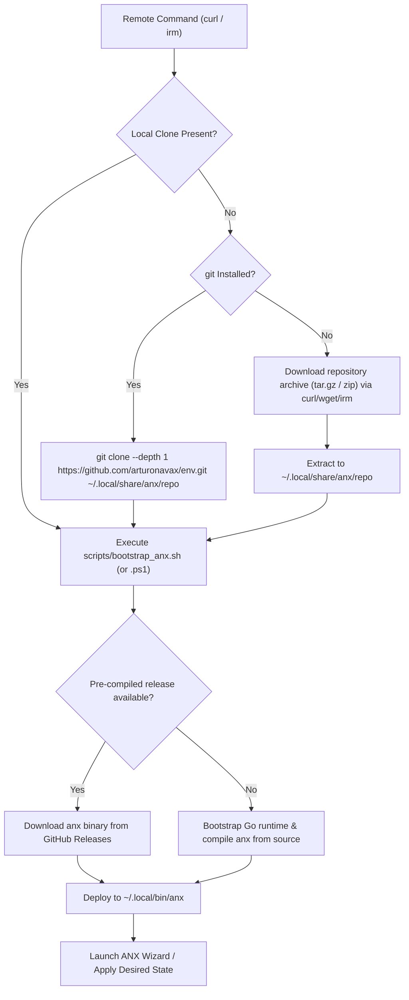

# Remote Installation Architecture & Subdomain Configuration

Comprehensive guide for deploying and configuring the zero-dependency remote bootstrap endpoints for `arturonavax/env` and the `env.arturonavax.dev` subdomain.

---

## 1. Universal Remote Installation Commands

`arturonavax/env` provides native, zero-dependency remote bootstrap pipelines tailored to each operating system's canonical shell.

### Linux, macOS, BSD & Raspberry Pi (POSIX sh)

#### Interactive Guided Setup (Recommended)

Connects standard input to controlling terminal (`/dev/tty`) automatically when piped, enabling the full interactive Bubble Tea wizard:

```sh
curl -fsSL https://sh.arturonavax.dev/install.sh | sh
```

#### Shorthand via Cloudflare Edge Worker

```sh
curl -fsSL https://sh.arturonavax.dev | sh
```

#### Autonomous Unattended Provisioning

Applies desired state non-interactively for CI/CD runners or headless cloud workstations:

```sh
curl -fsSL https://sh.arturonavax.dev/install.sh | sh -s -- -y --profile developer
```

#### Safe Dry-Run Execution Plan Preview

Inspects the DAG execution plan and reports planned actions without touching the filesystem:

```sh
curl -fsSL https://sh.arturonavax.dev/install.sh | sh -s -- --plan
```

---

### Windows 10 / 11 (PowerShell)

#### Interactive Guided Setup

```powershell
irm https://sh.arturonavax.dev/install.ps1 | iex
```

#### Shorthand via Cloudflare Edge Worker

```powershell
irm https://sh.arturonavax.dev | iex
```

#### Autonomous Unattended Provisioning

```powershell
& ([scriptblock]::Create((irm https://sh.arturonavax.dev/install.ps1))) -Yes -Profile developer
```

---

### Windows (Command Prompt - CMD)

```bat
curl -fsSL https://sh.arturonavax.dev/install.bat -o %TEMP%\install.bat && %TEMP%\install.bat
```

---

## 2. Remote Bootstrap Engine Lifecycle

When executed remotely via `curl` or `irm`:



---

## 3. Subdomain Configuration (`sh.arturonavax.dev`)

With the unified ANX Platform, all bootstrap entry points reside cleanly at the repository root and are served dynamically by the Cloudflare Edge Worker.

### Universal Cloudflare Worker (Edge Routing & OS Detection)

The production Cloudflare Edge Worker operates on `sh.arturonavax.dev` (code located in `deploy/cloudflare/` and documented in [docs/cloudflare_worker.md](cloudflare_worker.md)).

With this Worker active:
- **Linux/macOS/BSD/Raspberry Pi**: `curl -fsSL https://sh.arturonavax.dev | sh`
- **Windows (PowerShell)**: `irm https://sh.arturonavax.dev | iex`
- **Explicit Subpaths**: Transparently forwards `/install.sh`, `/install.ps1`, `/install.bat`, etc.
- **Web Browsers**: Automatically redirects visitors to `https://arturonavax.dev/env` (or returns `install.sh` on `sh.`)
