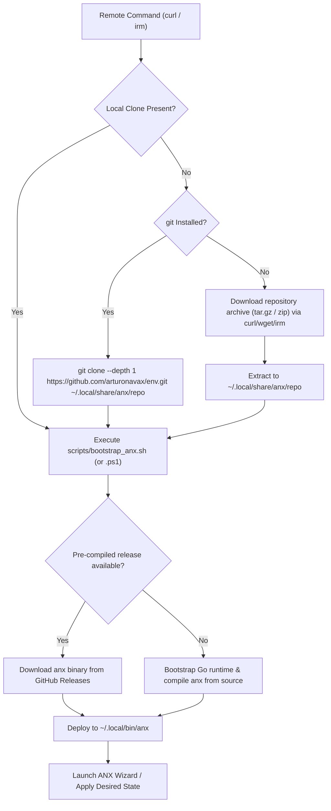

# Remote Installation Architecture & Subdomain Configuration

Comprehensive guide for deploying and configuring the zero-dependency remote bootstrap endpoints for `arturonavax/env` and the `env.arturonavax.dev` subdomain.

---

## 1. Universal Remote Installation Commands

`arturonavax/env` provides native, zero-dependency remote bootstrap pipelines tailored to each operating system's canonical shell.

### Linux, macOS, BSD & Raspberry Pi (POSIX sh)

#### Interactive Guided Setup (Recommended)

Connects standard input to controlling terminal (`/dev/tty`) automatically when piped, enabling the full interactive Bubble Tea wizard:

```sh
curl -fsSL https://env.arturonavax.dev/install.sh | sh
```

#### Shorthand via Cloudflare Edge Worker

```sh
curl -fsSL https://env.arturonavax.dev | sh
```

#### Autonomous Unattended Provisioning

Applies desired state non-interactively for CI/CD runners or headless cloud workstations:

```sh
curl -fsSL https://env.arturonavax.dev/install.sh | sh -s -- -y --profile developer
```

#### Safe Dry-Run Execution Plan Preview

Inspects the DAG execution plan and reports planned actions without touching the filesystem:

```sh
curl -fsSL https://env.arturonavax.dev/install.sh | sh -s -- --plan
```

---

### Windows 10 / 11 (PowerShell)

#### Interactive Guided Setup

```powershell
irm https://env.arturonavax.dev/install.ps1 | iex
```

#### Shorthand via Cloudflare Edge Worker

```powershell
irm https://env.arturonavax.dev | iex
```

#### Autonomous Unattended Provisioning

```powershell
& ([scriptblock]::Create((irm https://env.arturonavax.dev/install.ps1))) -Yes -Profile developer
```

---

### Windows (Command Prompt - CMD)

```bat
curl -fsSL https://env.arturonavax.dev/install.bat -o %TEMP%\install.bat && %TEMP%\install.bat
```

---

## 2. Remote Bootstrap Engine Lifecycle

When executed remotely via `curl` or `irm`:



---

## 3. Subdomain Configuration (`env.arturonavax.dev`)

In previous iterations, the subdomain pointed to the legacy `src/remotes/` folder. With the unified ANX Platform, all bootstrap entry points reside cleanly at the repository root.

### Method A: Cloudflare URL Redirect Rule (Zero Maintenance)

In your Cloudflare dashboard (or DNS provider):
1. Navigate to **Rules** -> **Redirect Rules** (or **Page Rules**).
2. Configure rule:
   - **Incoming Request**: `Hostname equals env.arturonavax.dev`
   - **Target URL**: `https://raw.githubusercontent.com/arturonavax/env/main/${1}`
   - **Status Code**: `302 Temporary Redirect`

This enables:
- `https://env.arturonavax.dev/install.sh` -> points to `/install.sh`
- `https://env.arturonavax.dev/install.ps1` -> points to `/install.ps1`
- `https://env.arturonavax.dev/install.bat` -> points to `/install.bat`
- `https://env.arturonavax.dev/scripts/install_golang.sh` -> points to standalone Go installer

---

### Method B: Universal Cloudflare Worker (Edge Routing & OS Detection)

If you want users to be able to run `curl -fsSL https://env.arturonavax.dev | sh` without typing `/install.sh`:

Deploy the production Cloudflare Edge Worker on `env.arturonavax.dev/*` documented in detail in [docs/cloudflare_worker.md](cloudflare_worker.md).

With this Worker active:
- **Linux/macOS/BSD/Raspberry Pi**: `curl -fsSL https://env.arturonavax.dev | sh`
- **Windows (PowerShell)**: `irm https://env.arturonavax.dev | iex`
- **Web Browsers**: Automatically redirects visitors to `https://arturonavax.dev/env`
